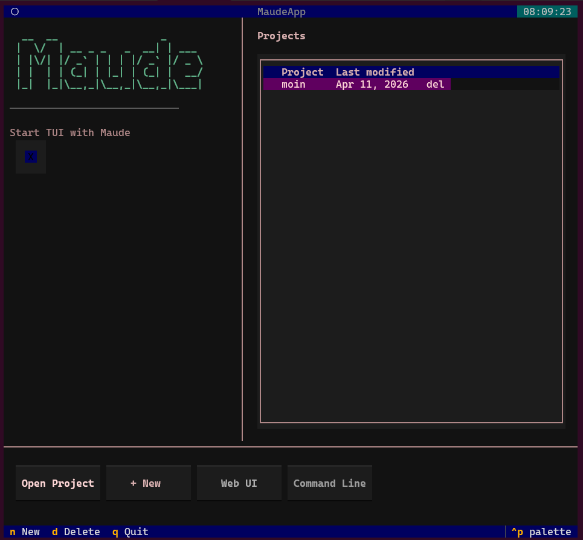

# TUI

The Maude TUI is a full-screen Textual program. In the sandbox it starts by itself when you open a terminal. Type `maude tui` or `menu` to start it again.



On Windows, `maude.exe` runs the same TUI. Some buttons are hidden there. See [maude.exe on Windows](windows-exe.md).

## Layout

The left side has the logo and the settings. The right side has the project list. The buttons are at the bottom.

Projects are sorted by last change, newest first. After you close a project, the cursor returns to it.

## Settings (left side)

| Control | What it does |
|---------|--------------|
| Autostart | The TUI starts at every new terminal. Clear the box to opt out. This creates `~/.maude-tui-disabled`, and you get the text banner instead. |
| Clear History | Off by default. When ticked, the next project you open starts Claude Code with no earlier conversation (no `--continue`). It is reset after each launch. |
| Perplexity MCP | Off by default. Saved in `~/.maude-perplexity`. When on, Maude adds the Perplexity Computer connector to Claude Code when you open a project, and runs `claude mcp login`. Clearing the box removes the connector. A connector that you added by hand is not touched while the box was never ticked. |
| Agent | `Claude Code` (default), `Codex`, `Antigravity`, `Grok CLI`, `Kiro CLI`, `GitHub Copilot CLI`, `OpenCode` or `Crush`. Saved in `~/.maude/maude-tool`. |
| Model | The models of the chosen agent. The first entry is always `auto`: Maude passes no model flag and the agent uses its own default. The list changes when you pick another agent (see below). Saved in `~/.maude/maude-model` together with the thinking level (`auto,high`, `opus,high`, `gpt-6.2-sol`). Maude also remembers the last model per agent in `~/.maude/agent-models.json`. |
| Thinking | `auto` (default, the agent decides), `low`, `medium`, `high`, `xhigh` or `max`. Only for agents with a reasoning-effort setting: Claude Code (`--effort`), Codex (`-c model_reasoning_effort=...`) and Antigravity (`--effort`). For the other agents the column is greyed out. Saved as the second field of `~/.maude/maude-model`. |

The columns are in the order Agent, Model, Thinking. With eight agents the left side is tall: it fits in a terminal of about 40 rows, and scrolls in a smaller one.

### Agents

| Agent | Command | Model flag | Resume |
|-------|---------|------------|--------|
| Claude Code | `claude [model] [--effort level]` | model as the first word (`--model` outside the sandbox) | `--continue` |
| Codex | `codex [-m model] [-c model_reasoning_effort=level]` | `-m` | `resume --last` |
| Antigravity | `agy [--model model] [--effort level]` | `--model` | `-c` |
| Grok CLI | `grok [-m model]` | `-m` | `-c` |
| Kiro CLI | `kiro-cli chat [--model model]` | `--model` | `--resume` |
| GitHub Copilot CLI | `copilot [--model model]` | `--model` | `--continue` |
| OpenCode | `opencode [--model provider/model]` | `--model` | `--continue` |
| Crush | `crush [--model provider/model]` | `--model` | `--continue` |

If the resume flag fails (nothing to resume), Maude starts the agent again without it, except for Claude Code, OpenCode and Crush. A missing agent prints a hint (`maude update` in the sandbox; Maude's install offer on Windows and macOS) and never crashes the TUI. Kiro CLI asks for a device-code sign-in on first use.

### Model lists

The list for each agent comes from a JSON file, never from the code alone:

1. Built in: a copy of [`light/maude-models.json`](https://github.com/dirkpetersen/maude/blob/main/light/maude-models.json) inside `maude.py` (used when nothing else is available, for example `maude.exe` offline).
2. `~/.maude/models-default.json`: that same file, downloaded in the background once per day (at or after noon, like `maude.py`). A download is checked first (valid JSON, every agent has a list) and written atomically. It takes effect at the next start.
3. `~/.maude/models.json` (optional, yours): per agent, `"models"` replaces the list and `"extra"` adds entries.

```json
{"agents": {"Codex": {"extra": [{"label": "mine", "id": "gpt-x"}]},
            "Crush": {"models": [{"label": "opus", "id": "anthropic/claude-opus-5-5"}]}}}
```

`label` is shown (keep it short, at most 12 characters, 9 fit the column) and `id` is what the agent's command line gets. `auto` is built in: it is always first and never listed twice. A corrupt file is ignored. If the saved model is not in the list of the chosen agent, `auto` is selected.

Claude Code, Kiro CLI, GitHub Copilot CLI, OpenCode, Crush and Grok CLI list `fable`, `opus`, `sonnet`, `haiku` first, then the vendor models (Codex: OpenAI; Antigravity: Gemini; Kiro CLI and GitHub Copilot CLI: OpenAI; Crush: OpenAI; Grok CLI: Grok). Grok CLI reaches Claude models only through a `[model.<id>]` entry in `~/.grok/config.toml`.

### Outside the sandbox

In `maude.exe` (Windows) and on macOS, the setting `native_only_approved` in `~/.maude/settings.json` is on by default. Then only Kiro CLI and GitHub Copilot CLI can be used: the other agents are greyed out in the Agent column (not hidden), and a saved agent that is not allowed is replaced by Kiro CLI. In the sandbox the setting has no effect. The Settings screen toggles it and calls `MaudeApp.apply_agent_restrictions()` to refresh the column; code that changes the file by hand calls the same method. `load_settings()` and `save_settings()` (atomic, mode 0600) read and write the file; a corrupt file is kept as `settings.json.bak` and the defaults are used.
## Buttons

| Button | What it does |
|--------|--------------|
| Open Project | Starts the agent in the project folder with the chosen model. It resumes the last session when there is one (`--continue` for Claude Code). |
| + New | Creates a project. Spaces become hyphens. Git is set up for you. |
| Web UI | Starts or stops the [kanna](https://github.com/jakemor/kanna) web UI at `http://127.0.0.1:3210`. |
| Setup Git | A 4-step wizard. See below. Also available as `maude github`. |
| Set Credentials | Opens a window where you paste `export` lines for Anthropic, Foundry, AWS or Azure. Maude saves them to `~/.azure/clauderc` (mode 0600). |
| Command Line | Closes the TUI and returns to the shell. |

## Keys

| Key | Action |
|-----|--------|
| `Enter` | Open the selected project |
| `n` | New project |
| `d` | Delete the selected project. It moves to `Projects/.deleted/`. |
| `q` | Quit to the shell |

## Credentials

If no LLM credentials are set, the TUI shows the credentials window at start. Maude checks `ANTHROPIC_API_KEY`, `ANTHROPIC_FOUNDRY_API_KEY`, `~/.aws/credentials` and `~/.azure/clauderc`. The Web UI button opens the same window when credentials are missing.

## Setup Git

The wizard has four steps:

1. Look up your GitHub user name to fill in name and email.
2. Find or make an ed25519 SSH key, and test it with `ssh -T git@github.com`.
3. Find or make a GPG key, and test it with a signed message.
4. Set `user.name`, `user.email` and `init.defaultBranch=main`. Install `keychain` and add it to `~/.bashrc`.

You paste the public keys into GitHub yourself. The wizard needs no `gh` login.

## Updates

The TUI downloads a new `maude.py` from GitHub once per day, at or after noon. The new version runs at the next start.
